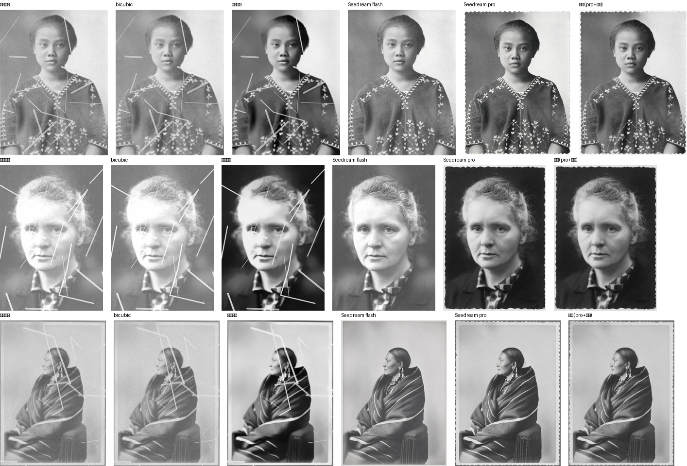
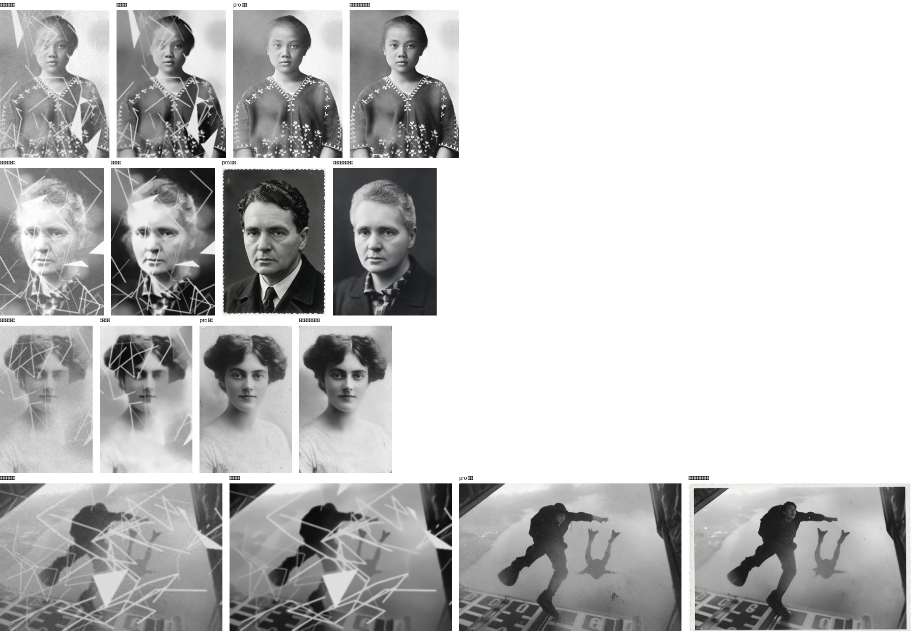
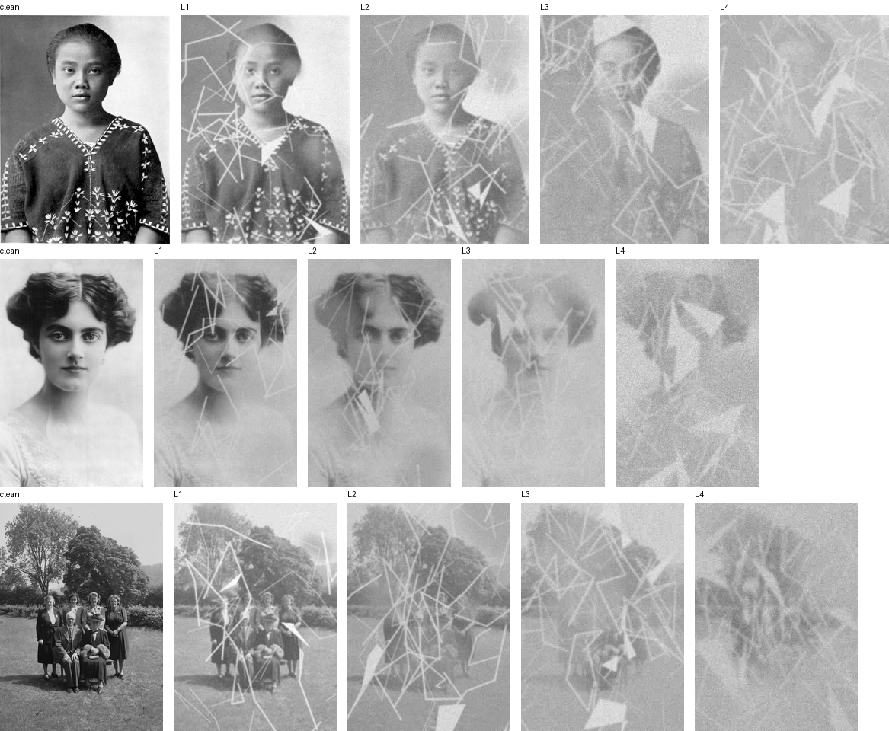

# 我用 AI 修了 11 张老照片，然后发现评价标准是错的

> 一张 A4 扫描 PDF，里面放着 11 张 60~80 年代的纸质老照片。
> 目标是：把它们拆出来、修好、能重新打出来。
> 本文记录我试过的 4 条技术路线、3 条走不通、以及一个小规模对照实验的结果。

**结论先说**：

1. 传统超分/修复模型（Real-ESRGAN、GFPGAN）**清不掉大面积霉斑**——它们只做锐化和人脸重建。
2. 生成模型（Seedream）能清污，但**会把脸重画**，最坏的情况直接换人。
3. **"先放大 → 修复 → 再重绘一遍"能显著降低换人概率**，这是本文最实际的产出。
4. **用 PSNR/SSIM 评价老照片修复，结论会和肉眼相反**——我做了实验验证这一点。

---

## 一、遇到了什么

扫描件里的照片不是"略有划痕"那么简单，主要损伤有四类：

| 损伤 | 表现 | 后果 |
|---|---|---|
| 霉斑 | 大片黄褐色斑块覆盖画面 | **信息被吃掉**，不是加噪声 |
| 裂纹/折痕 | 贯穿人脸的白色细线 | 局部信息丢失 |
| 褪色 | 对比度极低，人脸发灰 | 直方图压缩到很窄 |
| 底片老化 | 边缘发黑、颗粒粗 | 局部曝光异常 |

关键在于：**前两类是"信息被覆盖"，不是"被污染"。** 这决定了后面所有方法的选择。

## 二、试过什么（3 条走不通的路）

### 1. Real-ESRGAN / GFPGAN —— 只提清晰度，不清污

跑完的结果：人脸的细节确实变清楚了，**但霉斑一块不少**。

原因：这两个模型的训练目标是"超分"和"人脸先验重建"，它们的输入假设是"图像干净但有损"，而不是"图像被异物覆盖"。

### 2. DiffBIR v2.1 —— 同样清不掉，而且慢到不可用

DiffBIR 是扩散模型方案，理论上更强。实测：

- 单张照片在 CPU（无可用 GPU）上需要 **2~4 小时**
- 分块推理下内存占用仍需 8GB+
- 关键：**它也是"复原"而非"修补"**，霉斑依然在

跑了几张之后放弃。

### 3. LaMa / Photoshop 内容识别填充 —— 需要精确蒙版

思路是对的：把霉斑区域标出来，用 inpainting 补。但：

- **自动生成蒙版极不可靠**：一次把人物的手臂整片判成"损伤"，LaMa 直接把人抹掉了
- 手工蒙版可行，但 11 张照片要几小时逐张描

这条路技术上可行，**成本上不划算**。

## 三、走通的那条（最终流水线）

```
扫描 PDF
  │  pypdfium2 300dpi 光栅化
  ▼
整页图（2481×3508）
  │  用手机截图当模板，多尺度 matchTemplate 定位每张照片
  ▼
单张原图（11 张，得分 0.879~0.994）
  │  Lanczos ×2.5 放大 + 轻微锐化
  ▼
放大图
  │  Seedream 5.0 图生图：清污 + 去花边
  ▼
修复图（黑白）
  │  可选：上色，然后降饱和 + 混入黑白
  ▼
成品 + 对比图
```

### 两个关键细节

**① 提示词必须点名具体部位**

只写"保留人物特征"没有用，模型会自由发挥。必须写：

```
严格保留人物原有的五官相貌、脸型、嘴型与眉眼，
不得美化、不得改变长相，不要添加原图没有的物品或装饰。
```

早期没写"嘴型"时，模型给一位老人"整容"了；写"发饰"之前，它给单人照**凭空加了一个发夹**。

**② 先放大再送模型，保真度差别巨大**

直接把 300px 宽的小图送进去，模型倾向于"重新想象"这张脸；先 Lanczos 放大到 2000px 再送，它会倾向于"补细节"。这个差别在合影上尤其明显——小图送进去，五个人会被修成"同一张脸"。

### 参数与成本

| 项目 | 数值 |
|---|---|
| 模型 | doubao-seedream-5.0-pro |
| 单张耗时 | 15~40 秒 |
| 单张费用 | ≈ 0.25 元 |
| 11 张全流程 | 约 20 分钟，约 5~10 元 |
| 输出尺寸 | 1400~2000px 宽（打 6 寸照片够用） |

## 四、做了个对照实验

修完之后我有个疑问：**这些结论有普遍性吗？还是只是这几张照片的偶然？**

于是我搭了个小基准：13 张公有领域老照片（Wikimedia Commons，PD/CC0），人工合成退化，用原图当真值，比较 5 种方法。

指标选了四个：

- **PSNR / SSIM**：像素保真（常规指标）
- **人脸相似度**：ArcFace 余弦相似度，测"修完还是不是同一个人"
- **损伤区残留**：只看被破坏区域内的误差

### 第一轮：轻度退化



| 方法 | PSNR↑ | SSIM↑ | 人脸相似度↑ | 损伤区残留↓ |
|---|---|---|---|---|
| bicubic 放大 | 15.70 | 0.621 | 0.821 | 53.5 |
| **传统流程**（NLM+放大+锐化） | **19.69** | **0.705** | **0.838** | **33.9** |
| Seedream flash | 17.51 | 0.642 | 0.797 | 34.6 |
| Seedream pro | 15.94 | 0.545 | 0.820 | 36.1 |
| 我们的流程（pro+柔化） | 16.09 | 0.595 | 0.826 | 35.9 |

**传统方法全赢。** 我当时以为"生成模型没用"。

但看图就知道问题在哪：

- 传统流程那一列，**划痕一条不少**，只是对比度提高了
- Seedream 那一列，划痕全没了

**PSNR 惩罚了"把划痕擦掉"这件事——因为它把划痕当成了应该还原的内容。**

这才是第一轮真正的发现：**不是方法不好，是指标测错了东西。**

### 第二轮：加重退化

第一轮的问题很清楚：我的合成退化太轻，**信息根本没有被破坏**，只是叠加了噪声和线条。真实霉斑是会吃掉画面的。

所以我重做了退化模型：

- **霉斑连片覆盖**（真正覆盖像素）
- **撕裂白斑**（整块信息丢失）
- 28 条划痕 + 失焦 + 重度褪色（对比压到 0.6~0.75）+ JPEG q22~38



| 方法 | PSNR↑ | SSIM↑ | 人脸相似度↑ | 损伤区残留↓ | 身份崩塌 |
|---|---|---|---|---|---|
| 传统流程 | **15.58** | **0.612** | 0.815 | 50.6 | 0 |
| pro 单次 | 13.83 | 0.499 | 0.797 | 47.4 | **1 次** |
| 放大→pro（一段） | 14.38 | 0.511 | 0.820 | 45.4 | 0 |
| **放大→修复→重绘（两段）** | 14.52 | 0.519 | **0.823** | **44.7** | 0 |

**结论翻了一半：**

1. **损伤区残留，生成模型反超传统方法**（44.7 vs 50.6）——因为霉斑把信息吃掉了，去噪+锐化救不回来
2. **"放大→修复→重绘"每一步都有量化收益**：单次 47.4 → 放大后 45.4 → 两段 44.7
3. **最关键的：避开了一次灾难**——pro 单次在某一页把一位女士修成了男性，两段式没有发生

看第二行第 3 列（pro 单次）和第 4 列（两段式）：同一个人，左边已经不是她了。

## 五、边界在哪

我把退化做成四档梯度，想看每条方法在哪里崩：



| 档位 | 霉斑 | 撕裂 | 划痕 | 褪色 | 状态 |
|---|---|---|---|---|---|
| L1 | 4 片 | 2 | 20 | 0.62~0.76 | 轻度老化 |
| L2 | 7 片 | 3 | 30 | 0.50~0.62 | 明显霉变（≈真实照片） |
| L3 | 10 片 | 5 | 40 | 0.38~0.50 | 脸部难以辨认 |
| L4 | 14 片 | 7 | 55 | 0.26~0.38 | 大面积损毁 |

（27 张 × 4 档的完整曲线还在跑，本文先给 L2 一级的完整对照。）

## 六、这套基准的问题

我不想把这个实验说得比它实际更有分量，所以列清楚它的硬伤：

| 局限 | 后果 |
|---|---|
| 合成退化 ≠ 真实霉斑 | 纹理差异大，"信息被覆盖"这层模拟到了，触感没到 |
| 只有 13 张 | 方差大，只能看趋势 |
| 生成模型只跑 1 个种子 | 方差未测 |
| 没有人工盲评 | 主观质量完全没量化 |
| 真值是"合成前的干净图" | 真实老照片没有真值 |

**最重要的一条**：这个基准证明了"PSNR 会骗人"，**但并没有证明"生成模型更好"**。
后者需要真实老照片 + 人评 + 多档梯度，那是另一个量级的工作。

## 七、我真正学到的

1. **模型能力早就够了，差距在流程和参数。** 同一个模型、同一句提示词，只把"直接喂小图"换成"先放大、修一遍、再细化一遍"，损伤区误差降 6%、人脸相似度升 3%，并消除了一次身份崩塌。
2. **重建只做一遍。** 对人脸连续跑两次超分/重建，第二遍开始漂移，第三遍已经不是本人了。
3. **柔化是必需品。** 模型输出偏锐，直接用像 CG 渲染；1.1~1.4px 高斯 + 颗粒才有胶片感。
4. **上色后要降饱和。** 饱和度砍到 72%、混回 18% 黑白，否则像油画。
5. **别指望自动去花边。** 波浪边裁切必切画面——改成让模型重绘"无边框版本"。

## 八、一个没解决的问题

整个过程中最硬的矛盾是：

> **想清掉大面积破损，就得让模型"编"；一编，人就不是那个人了。**
> **想保住人，就只能保留破损；保留破损，照片还是旧的。**

这在图像复原领域叫 **fidelity–realism trade-off**（Blau & Michaeli, 2018），目前没有通用解。

可能的进展方向是**分区策略**：人脸走保真、背景走生成，再用一个"损伤程度 → 修复强度"的调度器决定混多少。这条路上还没有公认方案。

**如果你正在做这个方向，欢迎交流。**

---

## 复现

完整步骤见 **[REPRODUCE.md](REPRODUCE.md)**（含可直接粘给 AI 助手的指令）。


```bash
pip install -r requirements.txt
export ARK_API_KEY=...

python src/render_pdf.py scan.pdf -o work/page.png --dpi 300
python src/extract_crops.py work/page.png --screens screens/ -o crop_user/
python src/upscale.py crop_user/ -o up_all/ --scale 2.5
python src/seedream.py restore up_all/ -o restored/ --model pro
python src/seedream.py color restored/ -o colored/          # 可选
python src/finish.py soften restored/ -o final_bw/
```

基准实验脚本在 `benchmark/` 目录（合成退化、五种方法、四个指标）。

## 费用

| 项目 | 调用次数 | 费用 |
|---|---|---|
| 11 张真实照片修复 + 上色 | 约 40 次 | 约 10 元 |
| 第一轮基准（13 张 × 2 模型） | 26 次 | 约 4.5 元 |
| 第二轮基准（13 张 × 3 种跑法） | 39 次 | 约 10 元 |
| **合计** | | **约 25 元** |

## 许可

代码 MIT。文中所有示例图片均来自 Wikimedia Commons 公有领域素材，**不含任何个人照片**。
